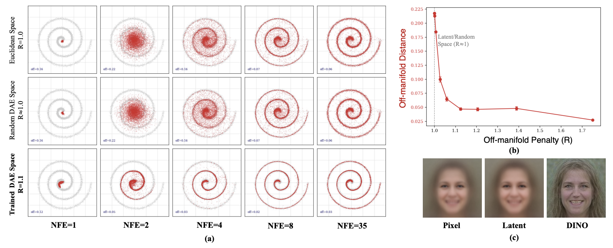

<div align="center">

# Perceptual Flow Matching para Generación Generativa en Pocos Pasos

<p>
  <strong>
    Chuyang Zhao<sup>1</sup>&nbsp; Yifei Song<sup>2</sup>&nbsp; Hongfa Wang<sup>3</sup>&nbsp; Jianlong Yuan<sup>1</sup>&nbsp;
    Yuan Zhang<sup>1</sup>&nbsp; Siming Fu<sup>1</sup>&nbsp; Zhineng Chen<sup>2</sup>&nbsp; Huilin Deng<sup>4</sup>&nbsp; Haoyang Huang<sup>1</sup>&nbsp; Nan Duan<sup>1</sup>†
  </strong>
</p>

<p>
  <sup>1</sup>Joy Future Academy&nbsp;&nbsp;
  <sup>2</sup>Fudan University&nbsp;&nbsp;
  <sup>3</sup>Tsinghua University&nbsp;&nbsp;
  <sup>4</sup>USTC
</p>

<p>
  <a href="https://arxiv.org/abs/2607.03524v1"></a>&nbsp;
  <a href="https://huggingface.co/papers/2607.03524"></a>&nbsp;
  <a href="https://huggingface.co/chuyangzhao/PerceptualFlowMatching"></a>&nbsp;
  <a href="https://github.com/ZhaoChuyang/PFM"></a>
</p>

</div>

## 📰 Noticias
- [2026/07/23] Publicamos el código de entrenamiento e inferencia, así como los checkpoints de PFM en SD3.

## Introducción

Proponemos Perceptual Flow Matching (PFM), un marco simple para la generación en pocos pasos en modelos de flow matching. Al supervisar el flow matching en un espacio de características perceptuales en lugar del espacio latente VAE convencional, PFM reduce los pasos de muestreo de 35–50 a 4–8, preservando la calidad de la generación.

<p align="center">
  
</p>


## Uso

### Configuración del Entorno

```bash
conda create -n pfm python=3.10 -y
conda activate pfm

pip install -r requirements.txt
```

### Entrenamiento

| Tarea | Conjunto de datos | LoRA | Modelo Perceptual | Backbone | Escala GFT | Script |
|------|---------|------|-----------------|----------|-----------|--------|
| T2I | COCO | ✗ | VGG+DINO | SD3-Medium | 1.0 | [train_sd3_coco_vgg+dino.sh](scripts/train_sd3_coco_vgg+dino.sh) |
| T2I | COCO | ✓ | VGG+DINO | SD3-Medium | 2.0 | [train_sd3_lora_coco_vgg+dino.sh](scripts/train_sd3_lora_coco_vgg+dino.sh) |
| T2I | COCO | ✗ | ConvNeXt+CLIP+DINO | SD3-Medium | 3.5 | [train_sd3_coco_clip+dino+convnext.sh](scripts/train_sd3_coco_clip+dino+convnext.sh) |


### Inferencia

```bash
cd /path/to/PFM
export PYTHONPATH=$PYTHONPATH:$(pwd)

torchrun --nproc_per_node=8 pfm/eval_sd3.py \
    --checkpoint /path/to/checkpoint/step_500.pth \
    --val_prompts_file evaluations/PartiPrompts.jsonl \
    --sampling_methods consistency \
    --num_steps 4,8 \
    --output_dir outputs/sd3_pfm/eval \
    --max_samples 64
```

## Agradecimientos

Este proyecto se basa en [HunyuanVideo](https://github.com/Tencent-Hunyuan/HunyuanVideo-1.5), [JoyAI-Image](https://github.com/jd-opensource/JoyAI-Image) y [FastVideo](https://github.com/hao-ai-lab/fastvideo). Agradecemos a los autores por su excelente trabajo.

## Contacto

Para cualquier consulta, por favor contacta a [Chuyang Zhao](mailto:chuyang.zhao@outlook.com)(chuyang.zhao@outlook.com).

Estamos buscandocontratando becarios en [JoyAI Research](https://research.joyai.com/). Si estás interesado, envía tu CV a [zhaochuyang.3@jd.com](mailto:zhaochuyang.3@jd.com).

## Citación

```bibtex
@misc{zhao2026perceptualflowmatchingfewstep,
      title={Perceptual Flow Matching for Few-Step Generative Modeling}, 
      author={Chuyang Zhao and Yifei Song and Hongfa Wang and Jianlong Yuan and Yuan Zhang and Siming Fu and Zhineng Chen and Huilin Deng and Haoyang Huang and Nan Duan},
      year={2026},
      eprint={2607.03524},
      archivePrefix={arXiv},
      primaryClass={cs.CV},
      url={https://arxiv.org/abs/2607.03524}, 
}
```

## Licencia

Este proyecto se distribuye bajo la licencia [Apache-2.0](LICENSE).
